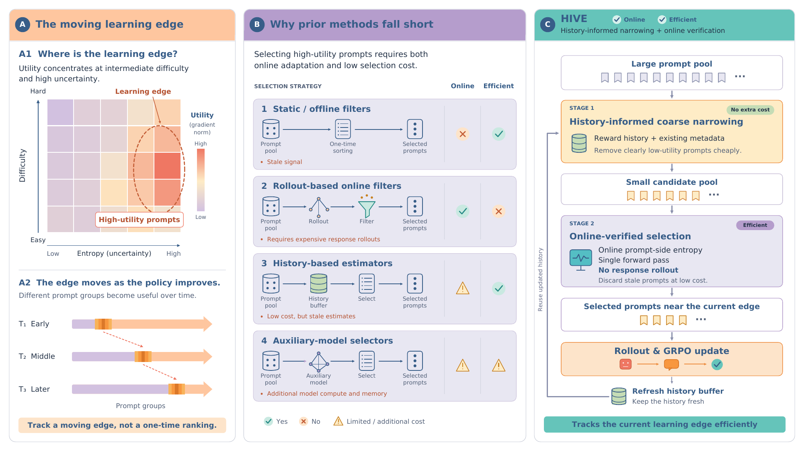
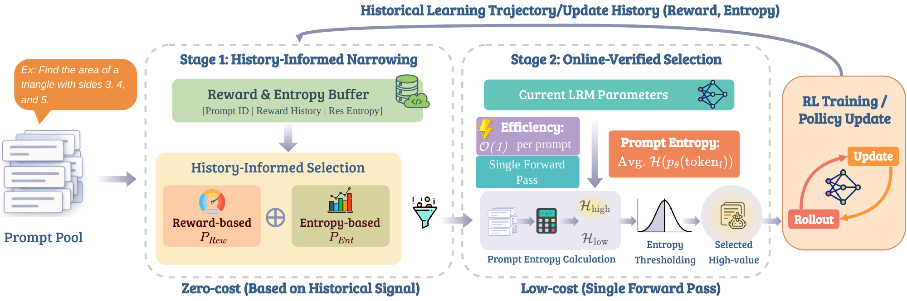

<div align="center">

# Train at the Moving Edge: Efficient RL for Large Reasoning Models via Rollout Selection

**NeurIPS 2026**

Jiahao Wu\*, Ning Lu\*, Shengcai Liu†, Kun Wang, Yanting Yang,<br>
Baijiong Lin, Chen Jason Zhang, Qing Li, Ke Tang

<sub>\* Equal contribution · † Corresponding author</sub>

[](https://arxiv.org/abs/2603.25184)
[](docs/installation.md)
[](LICENSE)

**History-informed narrowing. Online prompt-side verification. Fewer wasted rollouts.**

[Paper](https://arxiv.org/abs/2603.25184) · [Method](#method) · [Results](#main-results) · [Quick start](#quick-start) · [Citation](#citation)

</div>

HIVE selects useful prompts before expensive response generation in reinforcement learning with verifiable rewards. It combines historical reward and entropy metadata with a fresh, prompt-only forward pass, tracking the learning edge as the policy changes. The paper reports up to **2.3× overall training speedup** and **3.8× rollout speedup** over Dynamic Sampling while maintaining comparable reasoning performance.

<p align="center"></p>

## Method

1. **History-informed narrowing.** Reward-group histories identify repeatedly saturated prompts. The selector mixes this reward signal with the latest response entropy using `λ = 0.9`; unseen prompts receive a free first visit.
2. **Online verification.** Within each raw 32-prompt micro-batch, HIVE ranks Stage 1 survivors by current prompt entropy, keeps the top 50%, and rounds down to a multiple of eight. Selection requires no response rollout.
3. **Rollout and update.** Accumulate selected candidates, sample eight responses per prompt, remove exactly zero-variance reward groups, and top up until a complete GRPO update is available. Refresh history after the policy update using every generated group.

<p align="center"></p>

## Main results

**DAPO+MATH.** Average accuracy across six math benchmarks, reported at each method's best average checkpoint. Rollouts and elapsed time are measured up to that checkpoint. These are paper results, not measurements from the repository checks.

| Model | Avg. accuracy, DS → HIVE | Rollouts (M), DS → HIVE | Total hours, DS → HIVE | Speedup |
| :--- | :---: | :---: | :---: | :---: |
| Qwen2.5-Math-1.5B | 48.4 → **48.8** | 7.6 → **3.1** | 94.2 → **59.5** | 1.58× |
| DeepSeek-R1-Distill-Qwen-1.5B | 60.9 → 60.1 | 2.4 → **1.5** | 84.4 → **59.5** | 1.42× |
| Llama-3.2-3B-Instruct | 34.1 → **34.4** | 11.4 → **4.8** | 175.8 → **79.7** | 2.21× |
| Qwen3-4B-Base | 54.1 → **54.7** | 3.0 → **1.5** | 101.9 → **59.8** | 1.70× |
| Qwen2.5-Math-7B | 57.8 → **59.7** | 13.1 → **3.9** | 198.4 → **85.8** | 2.31× |

**Open-R1 (30k).** HIVE obtains 46.6 average accuracy with 1.5M rollouts on Qwen2.5-Math-1.5B and 55.3 with 2.5M rollouts on Qwen2.5-Math-7B; DS uses 3.8M and 11.4M rollouts, respectively.

## Quick start

The main experiments use **Linux, NVIDIA GPUs, and 8× A100**. Start with Qwen2.5-Math-1.5B. Installation and GPU execution must be checked in your training environment; repository CI exercises CPU logic and configuration only.

```bash
git clone https://github.com/JiahaoWuGit/HIVE-Efficient-Rollout-RL.git
cd HIVE-Efficient-Rollout-RL
conda env create -f environment.yml
conda activate hive
python -m pip install -r requirements.txt
python -m pip install ninja
python -m pip install flash-attn==2.7.4.post1 --no-build-isolation
python -m pip install -e . --no-deps
python -m pip check
python scripts/check_environment.py
```

See [installation notes](docs/installation.md) for CUDA, model compatibility, and the pinned dependency environment.

**Prepare training and evaluation data:**

```bash
python scripts/prepare_data.py --dataset dapo-math
```

This produces DAPO+MATH training files and all six evaluation sets. For Open-R1, use `--dataset openr1`. See [data sources and snapshot handling](docs/data.md).

**Inspect the command, then train:**

```bash
python scripts/train.py --model qwen25-math-1.5b --dataset dapo-math --dry-run
bash train-scripts/math_qwen_1_5b_dm_hive.sh
```

Runs write a resolved configuration, console log, JSONL metrics, and checkpoints under `outputs/`. W&B is optional: authenticate separately and add `--wandb`.

```bash
# Larger main model / alternate training corpus
python scripts/train.py --model qwen25-math-7b
python scripts/train.py --model qwen25-math-1.5b --dataset openr1

# Explicit paths and a short integration run
python scripts/train.py --model-path /path/to/model --data-root /path/to/data \
  --steps 5 --test-freq 5 --save-freq 5 --output-dir outputs/smoke

# Select the best validation checkpoint and its rollout count
python scripts/summarize_results.py outputs/smoke/metrics.jsonl
```

## Repository structure

```text
configs/models.json                Main-model paths, context lengths, batch sizes
scripts/prepare_data.py             Dataset conversion and snapshot metadata
scripts/train.py                    HIVE main-experiment launcher
scripts/summarize_results.py        Best-checkpoint evaluation summary
scripts/model_merger.py             FSDP checkpoint export to Hugging Face format
train-scripts/                     Convenience launchers
verl/trainer/ttis/hive_selection.py Pure selection rules
verl/trainer/ttis/presampling_selector.py  Per-prompt reward history and Stage 1
verl/trainer/ppo/ray_trainer.py      Selection, rollout, GRPO, and history refresh
assets/                            Overview and method figures from the paper
docs/                              Installation and data guides
tests/                             CPU regression checks
```

## Citation

```bibtex
@inproceedings{wu2026hive,
  title     = {Train at the Moving Edge: Efficient RL for Large Reasoning Models via Rollout Selection},
  author    = {Jiahao Wu and Ning Lu and Shengcai Liu and Kun Wang and Yanting Yang and Baijiong Lin and Chen Jason Zhang and Qing Li and Ke Tang},
  booktitle = {Advances in Neural Information Processing Systems},
  year      = {2026},
  url       = {https://arxiv.org/abs/2603.25184}
}
```

Machine-readable citations: [CITATION.cff](CITATION.cff) · [CITATION.bib](CITATION.bib).

## Acknowledgements and license

HIVE builds on [verl](https://github.com/volcengine/verl), [GRESO](https://github.com/Infini-AI-Lab/GRESO), and [vLLM](https://github.com/vllm-project/vllm). We thank their authors and the model and dataset providers. See [ACKNOWLEDGEMENTS.md](ACKNOWLEDGEMENTS.md) for attribution.

Code is released under [Apache 2.0](LICENSE). Third-party models and datasets retain their respective licenses and access conditions.
